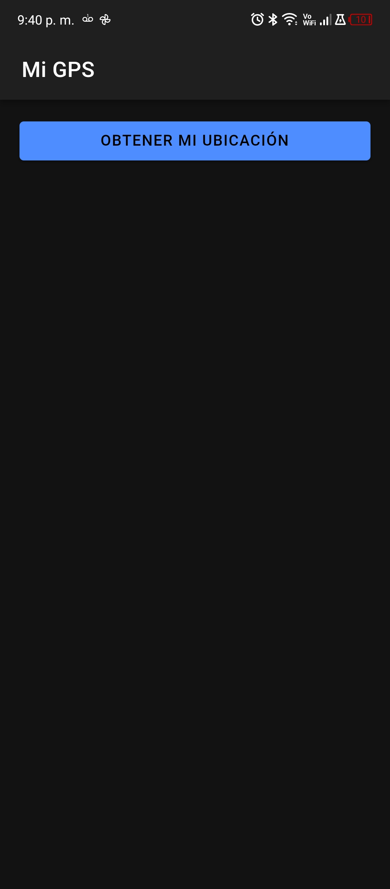
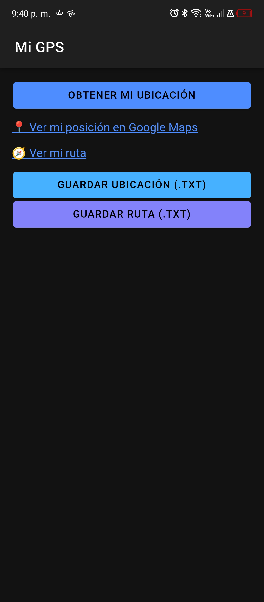
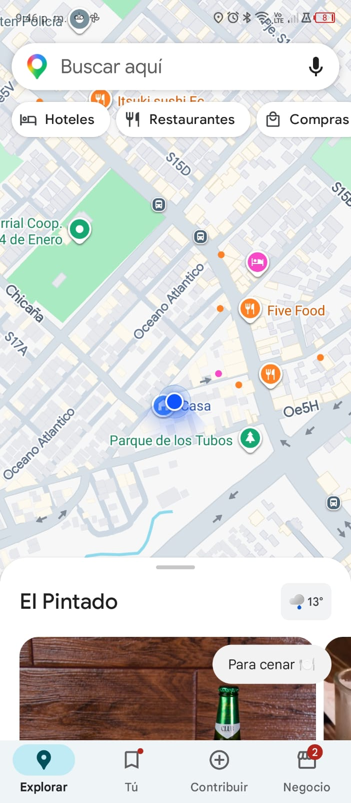
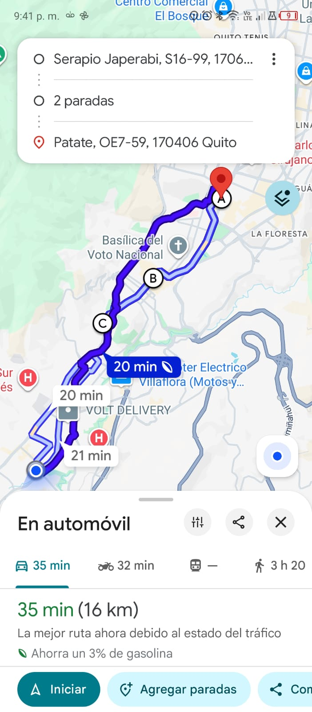
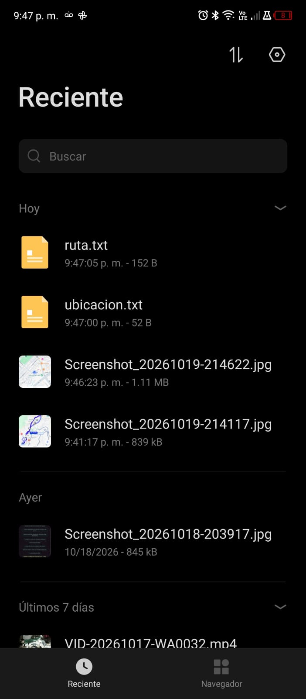
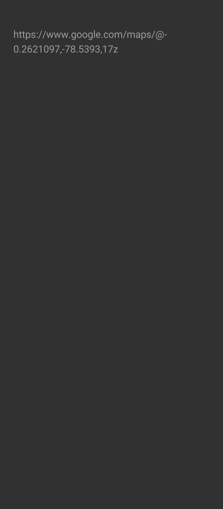

# 📍 GPS Ionic: ubicación y ruta con Google Maps

Aplicación móvil hecha con **Ionic + Angular + Capacitor** que obtiene la posición GPS del dispositivo, genera enlaces de **Google Maps** para ver la ubicación y una ruta, y permite **guardar esos enlaces en archivos `.txt`**.

## Funcionalidades

1. **Hipervínculo a mi posición:** abre Google Maps en las coordenadas GPS actuales.
2. **Hipervínculo a una ruta:** abre Google Maps con una ruta desde mi posición actual hasta un destino (casa, parque o sitio de interés), pasando por paradas intermedias.
3. **Guardar ubicación:** botón que guarda la URL de la ubicación en `ubicacion.txt`.
4. **Guardar ruta:** botón que guarda la URL de la ruta en `ruta.txt`.

## Capturas de pantalla

> Reemplaza estas imágenes por tus capturas reales (carpeta `docs/screenshots/`).

|                  Pantalla principal                   |              Enlaces generados              |              Mi posición en Google Maps              |
| :---------------------------------------------------: | :-----------------------------------------: | :--------------------------------------------------: |
|  |  |  |

|            Ruta en Google Maps             |              Archivo guardado              |            Archivo .txt abierto             |
| :----------------------------------------: | :----------------------------------------: | :-----------------------------------------: |
|  |  |  |

## Tecnologías

| Tecnología                   | Uso                              |
| ---------------------------- | -------------------------------- |
| Ionic + Angular (standalone) | Interfaz y componentes           |
| `@capacitor/geolocation`     | Obtener la posición GPS          |
| `@capacitor/browser`         | Abrir los enlaces de Google Maps |
| `@capacitor/filesystem`      | Guardar los archivos `.txt`      |
| `@capacitor/android`         | Plataforma Android               |

## Cómo funciona

### Enlace a mi posición

```
https://www.google.com/maps/@{LAT},{LNG}
```

`LAT` y `LNG` son las coordenadas obtenidas con `Geolocation.getCurrentPosition()`.

### Enlace de la ruta

```
https://www.google.com/maps/dir/?api=1&origin={LAT,LNG}&destination={LAT,LNG}&waypoints={LAT,LNG}%7C{LAT,LNG}
```

- **origin:** mi posición actual (GPS).
- **destination:** sitio fijo definido en el código (`destino`).
- **waypoints:** paradas intermedias fijas definidas en el código (`paradas`), separadas por `%7C`.

Las coordenadas de destino y paradas están escritas directamente en `src/app/home/home.page.ts`; para cambiar la ruta basta con editar esos valores:

```ts
destino = { lat: -0.229415, lng: -78.524581 };
paradas = [
  { lat: -0.201452, lng: -78.498124 },
  { lat: -0.220164, lng: -78.512328 },
];
```

### Guardado en archivos

Los botones usan `Filesystem.writeFile` para escribir la URL en `Documents/gps/ubicacion.txt` y `Documents/gps/ruta.txt`, y muestran un aviso con la ruta del archivo guardado.

## Estructura del proyecto

```
src/app/home/
├── home.page.ts     # Lógica: GPS, URLs, abrir enlaces y guardar .txt
└── home.page.html   # Botón, enlaces y botones de guardado
android/             # Proyecto Android generado por Capacitor
```

## Permisos de Android

En `android/app/src/main/AndroidManifest.xml`:

```xml
<uses-permission android:name="android.permission.ACCESS_FINE_LOCATION" />
<uses-permission android:name="android.permission.ACCESS_COARSE_LOCATION" />
<uses-feature android:name="android.hardware.location.gps" />
<uses-permission android:name="android.permission.WRITE_EXTERNAL_STORAGE" android:maxSdkVersion="28" />
```

## Requisitos previos

- Node.js y npm
- Ionic CLI: `npm install -g @ionic/cli`
- Android Studio con un SDK instalado
- Un teléfono Android con depuración USB activada (o un emulador)

## Instalación y ejecución

```bash
# 1. Clonar el repositorio
git clone <URL-DE-TU-REPOSITORIO>
cd gps-ionic

# 2. Instalar dependencias
npm install

# 3. Probar en el navegador
ionic serve

# 4. Compilar y sincronizar con Android
ionic build
npx cap sync android

# 5. Abrir en Android Studio y ejecutar en el teléfono
npx cap open android
```

> En el navegador la ubicación funciona, pero los archivos `.txt` no se crean como archivos reales; esa parte se prueba en el teléfono.

## Cómo probar la app

1. Abre la app y pulsa **Obtener mi ubicación**; acepta el permiso de ubicación.
2. Toca **Ver mi posición en Google Maps**: se abre el mapa en tu posición.
3. Toca **Ver mi ruta**: se abre Google Maps con la ruta y sus paradas.
4. Pulsa **Guardar ubicación (.txt)** y **Guardar ruta (.txt)**: aparece un aviso con la ubicación del archivo.
5. Abre el gestor de archivos del teléfono y revisa `Documents/gps/`.

## Autores

- Josue Alexander Patiño Rojas
- <NOMBRE DE TU PAREJA, si aplica>

ESFOT, Escuela Politécnica Nacional.
